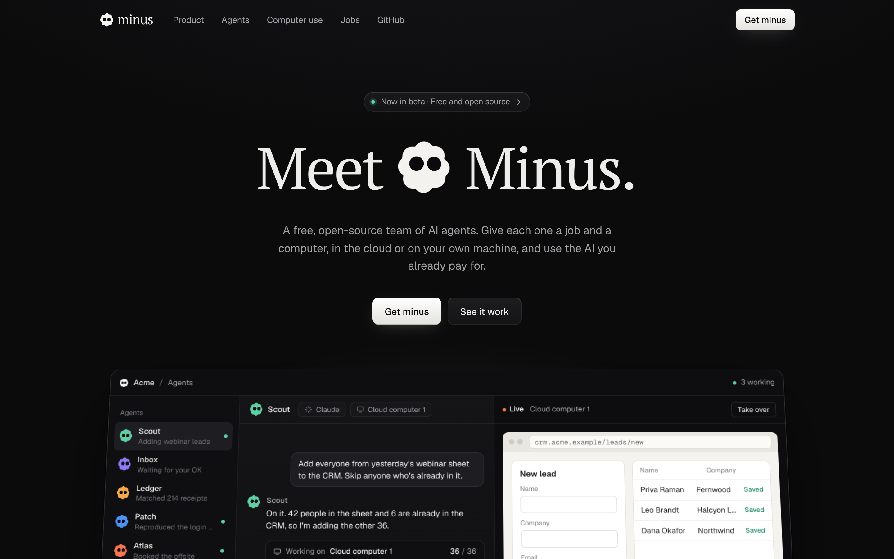
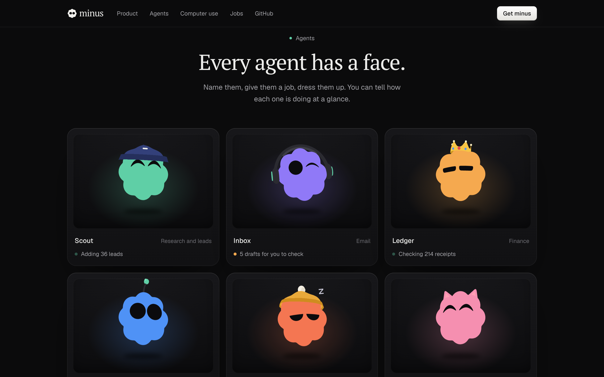

<p align="center">
  
</p>

<h1 align="center">minus</h1>

<p align="center">
  A free, open-source team of AI agents that work on real computers.<br />
  In the cloud or on your own machine, with the AI you already pay for.
</p>

<p align="center">
  <a href="https://getminus.vercel.app"><b>Website</b></a> ·
  <a href="https://getminus.vercel.app/lab.html">Mascot lab</a> ·
  <a href="LICENSE">MIT License</a>
</p>

<p align="center">
  
</p>

> **Minus is in beta.** This repository currently holds the website, the mascot and the app's interface. The agent runtime is being built in the open, here.

## What Minus is

- **A team, not a chatbot.** Create agents, give each one a job, and let them hand work to each other.
- **Real computers.** Every agent gets its own computer in the cloud, or uses yours with your apps and logins. It clicks, types and moves between windows the way you do, and every action is logged.
- **Your AI, your keys.** Connect the subscriptions and API keys you already have (Claude, ChatGPT, Codex, Gemini, Grok, Llama, Ollama, OpenRouter or any OpenAI-compatible API), or run a model locally. Minus never charges for AI.
- **You stay in charge.** Agents ask before anything they can't undo, like sending email or spending money. You decide what each one may do on its own.
- **Routines.** Show an agent a task once and it runs it on a schedule.
- **Free and open source,** under the MIT license.

## Every agent has a face

<p align="center">
  
</p>

Each agent is a small cloud-shaped character with its own color, expression and accessories. It is a real 3D model drawn in flat colors, so it reads like a 2D illustration while it turns, blinks, looks around and reacts.

- **Expressions** are drawn as eye shapes that morph smoothly into each other, each with its own body motion.
- **Accessories** are real 3D props in flat colors, never outlines. Hats are cut from the head's own shape, so they fit.
- **No WebGL?** The mascot falls back to a flat 2D drawing with the same face and motion.

Try them all in the [mascot lab](https://getminus.vercel.app/lab.html).

## Repository

```
site/                 the website, the mascot lab and the app interface
  index.html          landing page with the scored intro
  lab.html            mascot lab: every expression, accessory and color
  js/
    mascot3d.js       the mascot: shape, eyes, expressions, accessories, motion
    shape.js          the silhouette and flat SVG avatars, shared by 2D and 3D
    sound.js          the intro score and interface sounds, synthesized live
    intro.js          the intro timeline
    hero.js           "Meet [ … ] Minus." and the agent picker
    landing.js        the landing page sections
    app.js            the app preview on the landing page
    computer.js       the scripted computer-use demo
    magic-text.js     letter-level text morphing
    names.js          keeps product and agent names out of browser translation
  vendor/             third-party libraries, copied in (no CDN at runtime)
  build/stamp.sh      versions asset URLs for deploys
mascot/               the first standalone mascot prototype
docs/                 images for this README
```

## Run it locally

You need Node 18 or newer.

```sh
git clone https://github.com/ThatMaxwell/Minus
cd Minus/site
npm install
npm start            # http://localhost:7000
```

Add `?nointro` to the URL to skip the intro while you work on the page. The site is plain static files with no build step.

## Deploy

- **GitHub Pages:** `.github/workflows/pages.yml` publishes `site/` on every push to `main` that changes it. Asset URLs are stamped with the commit so browsers never mix cached files from two deploys.
- **Vercel:** set the project's root directory to `site`, framework to "Other", and leave the build command empty.

## Built with

All MIT licensed, and copied into `site/vendor/`. Run `npm run vendor` in `site/` to refresh them.

- [three.js](https://github.com/mrdoob/three.js) for the 3D mascot
- [Elementary Audio](https://github.com/elemaudio/elementary) for the sound: every note in the intro is synthesized live by a DSP engine compiled to WebAssembly, with no audio files
- [Motion](https://github.com/motiondivision/motion) for springs, scroll-linked and in-view animation
- Fonts: [PT Serif](https://fonts.google.com/specimen/PT+Serif) and [Geist](https://vercel.com/font)
- Provider logos from [Simple Icons](https://simpleicons.org) (CC0) and [Lobe Icons](https://github.com/lobehub/lobe-icons) (MIT). Product names and logos belong to their owners and are shown only to say what Minus works with.

## Contributing

Issues and pull requests are welcome. If you are planning something large, open an issue first so we can talk it through.

## License

[MIT](LICENSE) © ThatMaxwell and Minus contributors
