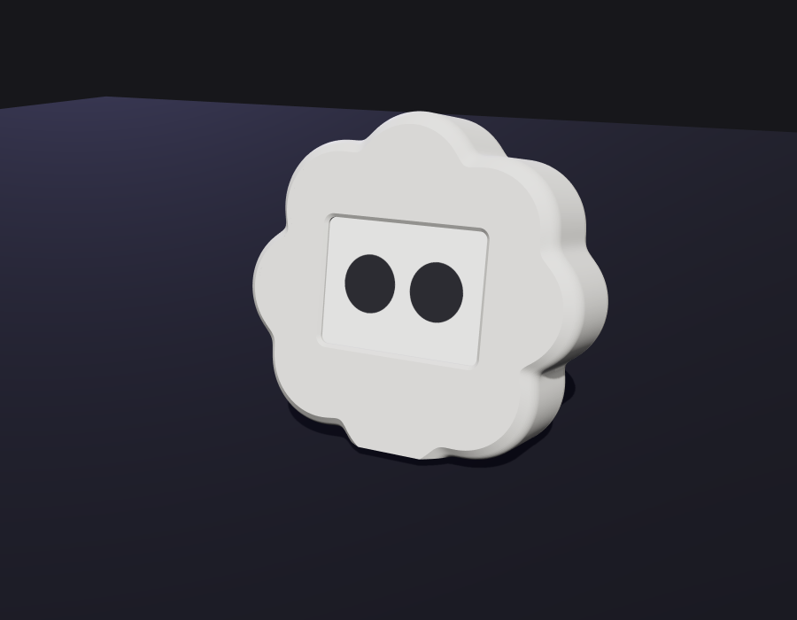

# Minus, the desk buddy

A printable Minus for your desk. A CYD (ESP32 touchscreen board) goes inside, and its screen is
Minus's face. About 12 × 11 × 4 cm: it fits in your hand.

## Print

| | |
|---|---|
| `minus-front.stl` | the body, **face down** on the bed |
| `minus-back.stl`  | the back cover, as it comes (flat side down, posts up) |

PLA or PETG, 0.2 mm layers, 3 walls, 15% infill, **no supports** (the edges start at 45° so
they print face-down cleanly). White, like Minus. A textured bed gives the face a nice finish.

## Put it together

1. Slide the CYD in face first, so the screen sits in the four corner guides behind the window.
2. The USB port goes to the right side, where the slot is.
3. Press the back cover in. Its four posts hold the board against the face.

## Your screen is a different size?

Measure it and change the numbers at the top of `minus_desk.py` (millimetres), then run
`pip install manifold3d numpy` and `python3 minus_desk.py`:

- `win_w`, `win_h`: the window, a little smaller than the screen's visible area
- `disp_w`, `disp_h`: the display's outline, for the corner guides
- `disp_stack`: from the front of the glass to the front of the board
- `pcb_w`, `pcb_h`: the board; `pcb_dx`, `pcb_dy` if the screen isn't centred on it
- `usb_side`, `usb_dy`, `usb_dz`: where the USB port is
- `R`: the size of the whole body (the script tells you if the board doesn't fit)
